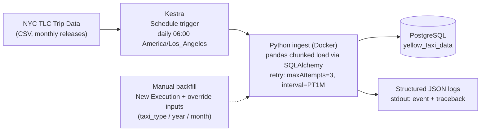
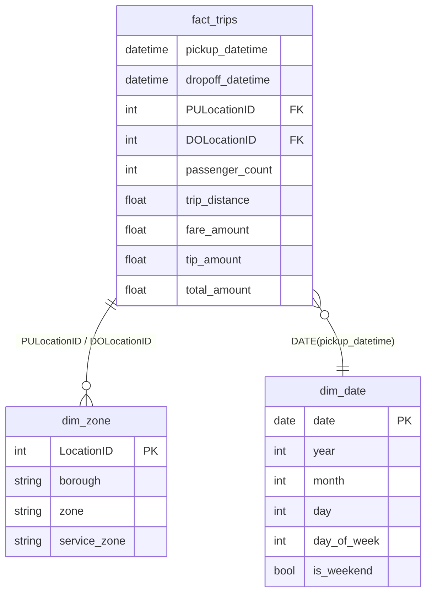

# de-zoomcamp-project

## 8 weeks NY tax data pipeline

## Scheduling
- Kestra schedule trigger: automatically fires the ingest flow daily at 06:00 (America/Los_Angeles)
- Inputs have defaults (yellow / 2021 / 01); scheduled runs use the defaults, manual runs can override them via New Execution
- The schedule is evaluated by polling, so actual runs may start a dozen minutes late (e.g., the 10/07 run started at 06:18) — this is normal

## Backfill
- The scheduler only covers "from today onward"; historical months are never backfilled automatically — trigger a New Execution manually and change the inputs (taxi_type / year / month)
- Backfilled yellow 2021-01 (1,369,765 rows), 2021-02, 2021-03 (1,925,152 rows) — all Success
- Typical scenarios: backfilling history for a new pipeline, re-running after a bug fix, late-arriving data

## Retry on Failure
- Task-level retry: maxAttempts=3 (1 initial attempt + up to 2 retries), interval=PT1M
- Verified: intentionally broke the download URL → marked Failed after all 3 attempts failed (execution `1kdbwSn8`, ~2m 28s); re-ran successfully after fixing the URL (execution `4z0UaovR`)
- Structured JSON logs go to stdout: `"event": "failed"` + traceback pinpoints the download 404 directly

## Idempotency
- Known issue: the first chunk of each execution currently uses `if_exists="replace"`, which wipes the whole table — after backfilling 01→02→03 in sequence, only March data actually remains
- Next step: switch to per-month delete+insert (or check whether the target month already exists before writing), so re-runs neither duplicate nor lose data

